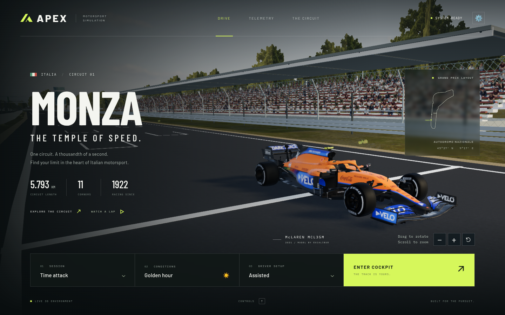

# APEX — Monza

A playable browser simulator set on a geographically reconstructed **Autodromo Nazionale Monza**. Built with Three.js, a 120 Hz driving model, local photographic materials, and Excalibur’s detailed 2021 McLaren MCL35M.



## Run

Use Node.js 24 LTS (pinned in `.nvmrc`; the supported minimum is 20.19 or 22.12) and a modern browser with WebGL 2. Hardware graphics acceleration is strongly recommended.

```sh
cd f1-simulator-github
npm ci
npm run dev
```

Open the local address Vite prints (normally `http://localhost:5173`). Select **Enter cockpit** to drive or **Watch a lap** to follow the demonstration driver. In a demonstration, **Take control** hands the car over to you; the current partial lap is invalidated, and the next full clean lap can set a personal best.

On the home page, **drag the McLaren to rotate the view** and **scroll or pinch to zoom**. The − / + buttons also zoom, and the circular arrow resets the view. Keyboard users can focus the car viewer with Tab, use arrow keys to rotate, + / − to zoom, and Home to reset.

For a production build:

```sh
npm run build
npm run preview -- --port 4173
```

All runtime assets—including fonts, geographic data, the sky, ground materials and foliage—are bundled locally. After dependency installation, the simulator does not need a network connection. Do not open `index.html` directly as a file: use the local server.

## GitHub and deployment

This repository contains the complete simulator, including the McLaren model, fonts, track data and textures. Raw import archives and development screenshots are excluded. No Git LFS or asset download is needed to run it.

Push this folder to your repository to run the included build and simulation checks. The optional **Deploy to GitHub Pages** workflow is started manually after enabling GitHub Actions in Settings → Pages. Relative asset paths support project URLs without hard-coding a repository name. See [GitHub setup and deployment](docs/GITHUB.md) for the complete steps.

## Driving

| Action | Keyboard |
| --- | --- |
| Accelerate | W / Up arrow |
| Brake | S / Down arrow / Space |
| Steer | A, D / Left, Right arrows |
| ERS boost | Hold Shift |
| DRS in eligible zones | Hold E |
| Manual shift down / up | Z / X |
| Cockpit, pod, chase, nose cameras | C |
| Recover car; invalidates lap | R |
| Braking guide | L |
| Minimal HUD | H |
| Pause | Escape |
| Controls | ? |
| Fullscreen | F |

Standard gamepad: left stick steering, RT throttle, LT brake, A/Cross boost, Y/Triangle DRS, LB/RB downshift/upshift, Start pause/resume, View change camera. Connect and press a controller button to let the browser detect it. Touch steering and pedals appear on devices with coarse pointers.

Start with assisted handling and automatic gears. Brake **before** the tight first chicane; holding full throttle through it will put the car off the track. The assists smooth and stabilize input; they do not steer along the circuit for you. DRS cancels under braking. Fuel, tyre temperature/wear, battery deployment and damage affect the car.

The physical starting gantry and HUD illuminate five red columns in sequence; driving begins when they all go out. Pausing also holds the lights. You begin on the starting grid with an **out lap**. Monza's finish/control line is 309 m behind its start line: cross it to begin your first complete timed lap. The map labels both lines. Only complete clean laps can set a personal best. Touch devices show +/− shift buttons when automatic gears are disabled.

## Included

- Full 5,793 m circuit built from public geographic coordinates, with all 11 named corners.
- Textured asphalt, stepped 2024-style kerbs, runoff/gravel, upper catch fencing, marshal-panel geometry, populated grandstands, park foliage and a modeled historic bridge.
- Mapped garage, hospitality and podium placement, twelve service buildings, two glass towers and a reference-informed starting gantry with working paired red lights.
- The requested 2021 McLaren MCL35M: all 102,081 source triangles, original textures, animated wheels and steering, and the same model in cockpit, pod, chase and nose views.
- Independent tyre-force driving model, aero load/drag, combined braking/cornering grip, eight gears, boost, DRS, surface changes and barrier response.
- Four cameras, procedural engine/turbo/shift/wind/tyre/kerb sound, skid marks, loose-surface dust and impact sparks.
- Time attack and free practice, separate grid/control lines, sectors and DRS activation based on the FIA's 2025 offsets, personal-best ghost saved in the browser, live delta, telemetry plots and CSV export.
- Demonstration driver using the same tyre physics; demonstration laps never replace personal bests.
- Golden-hour, clear and overcast **dry** lighting presets. Performance, High and Ultra graphics.
- Keyboard, standard gamepad and touch input; pause on focus loss; responsive interface.

## Fidelity boundaries

This is an ambitious independent simulator prototype, not a laser-scanned commercial F1 simulation. The centerline, pit/service footprints and tower positions use geographic data. Width is currently constant at 12 m; elevation is flat. Building heights and facades, track edges, vegetation placement, kerbs and friction are authored approximations. Dated panoramas and photographs inform appearance; the environment is not an exact single-season survey or a reconstruction of the 2026–2027 works. The visible car is Excalibur’s **2021 McLaren MCL35M**. Wheelbase, radius and collision dimensions match the imported mesh; hybrid power, aero and tyre coefficients remain authored approximations, not validated MCL35M telemetry. The physics is planar rather than a complete four-wheel suspension/contact-patch model. There are no AI race opponents, network multiplayer, force feedback, wet-contact physics or professional driver-training certification.

The project is not affiliated with Formula 1, a racing team or Autodromo Nazionale Monza. See [track provenance](docs/TRACK.md), [physics assumptions](docs/PHYSICS.md), [car construction](docs/CAR.md), and [asset sources and generated-art prompt](docs/ASSETS.md).

## Graphics

Performance is the initial setting on small or memory-constrained devices. It uses adaptive render scaling (approximately 65–85% of CSS resolution), direct antialiased rendering and lower shadow resolution, while preserving track geometry, materials and physics. High/Ultra add bloom and cinematic postprocessing. Scenery instances are divided into 300 m regions so off-screen sections can be culled. The upper presets are intended for faster graphics hardware.

The 4,261 grandstand spectators use eight generated portraits in six instanced draws, with geometric crowd fallback if the image cannot load. Live mirror rendering is disabled. Paused menus retain the frozen scene; changing graphics or resizing the window redraws it. Older saved ghosts from the shared start/finish implementation are ignored because their timing origin differs.

If the scene is very slow, enable browser hardware acceleration and choose Performance. The FPS counter appears while driving. Software WebGL renderers can be dramatically slower than the integrated GPU.

## Verification

```sh
npm test
npm run build
npm run check:dist
npm run test:deployment
# Start the production preview in another terminal, then:
npm run test:browser
npm run test:controls
npm run test:viewer
npm run test:track
# Optional hardware profiling:
npm run test:performance
```

The physics tests cover acceleration/braking, gears, boost/DRS, tyre and surface behavior, impacts, reset, frame-rate stability and input release. The demonstration regression completes three timed Monza laps and validates lap timing, sectors, ghost endpoints, storage reload, demo isolation and corrupted-save handling. Timing tests distinguish the geographic start-grid seam from the control line and reject finish-line teleports and timing gaps. The browser test exercises the actual rendered app, the McLaren model identity, driving/braking, camera switching, pause and resize, telemetry, settings, recovery, mobile layout, lighting presets, demonstration handover and both rendering pipelines. The controls test exercises actual touch events, manual shifting and gamepad pause/camera mappings; screenshots and hardware-profile JSON are written to `artifacts/`.

Install the test browser once with `npx playwright install chromium`. Tests use that browser by default; set `CHROMIUM_PATH` for a system browser, `APEX_GRAPHICS=gl` for hardware ANGLE/OpenGL, or `APEX_GRAPHICS=swiftshader` for software rendering. Set `APEX_URL` for a different preview URL. Software-rendered measurements are not hardware FPS results. Inspection pages/scripts in `tests/` support isolated car, world and graphics diagnostics.

The car-viewer test checks mouse orbit, bounded wheel/button zoom, keyboard reset, actual touch/pinch/cancellation, modal isolation, cockpit and chase transitions, and portrait/landscape layouts.

The track test checks mapped structures, kerb/panel metadata, synchronized physical and HUD red lights, pause/resume and lights-out release. It also captures six detailed scenery views and the high-quality starting signal under all three lighting presets. Unit tests check source coordinates, tower/barrier clearances and sequence boundaries. Visual-reference sources and accuracy limits are linked from [TRACK.md](docs/TRACK.md).

## Credits

This work is based on [“F1 2021 McLaren MCL35M”](https://sketchfab.com/3d-models/f1-2021-mclaren-mcl35m-967ecec37468412083c40c62b3d7234d) by [Excalibur](https://sketchfab.com/excalibur), licensed under [CC BY 4.0](https://creativecommons.org/licenses/by/4.0/). The production assets and their notices are included. OpenStreetMap, circuit-data, font, texture and Three.js notices retain their respective licenses; see [asset provenance](docs/ASSETS.md). No project-wide license has been assigned to the original simulator code.
